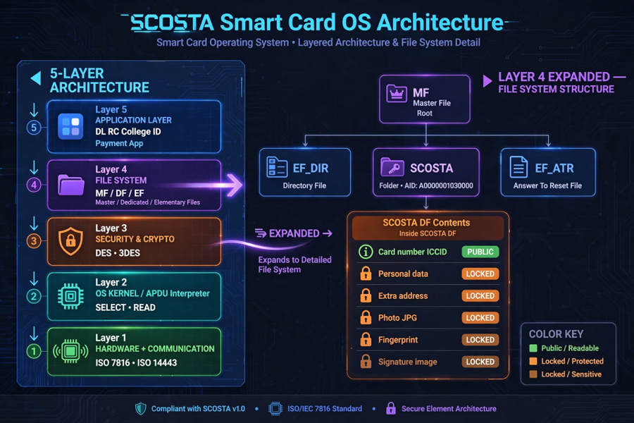
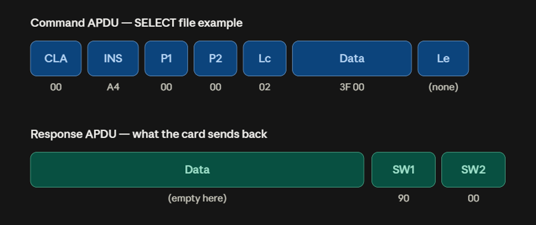
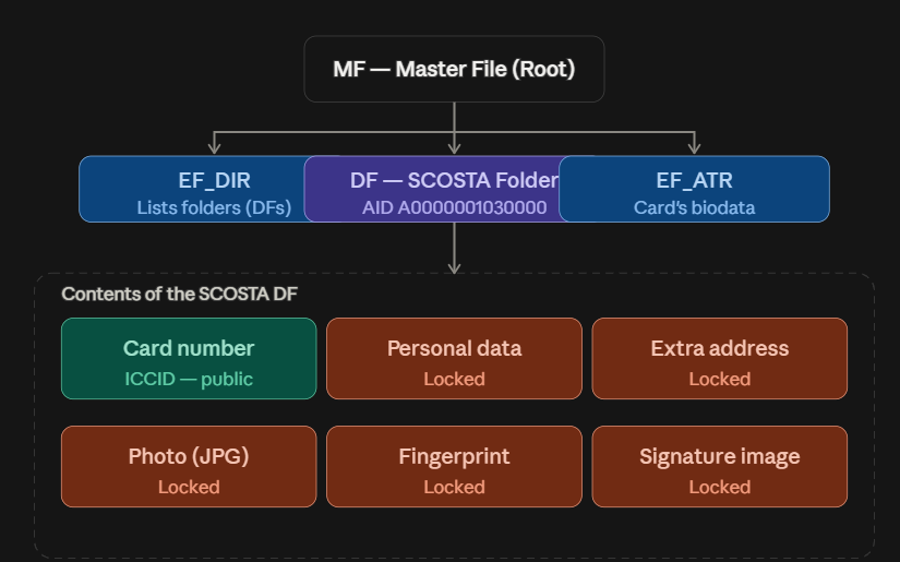

# ACR1281 Card Reader - Python Web App (VENV Setup)

## 📁 Project Structure
```
acr1281_full_project/
├── venv/                  # Virtual environment (setup ke baad banega)
├── templates/
│   └── index.html         # Website UI
├── static/
├── app.py                 # Main Flask app
├── acr1281_reader.py      # ACR1281 hardware driver
├── models.py              # Database model
├── requirements.txt       # Saari libraries
├── setup_venv.sh          # Linux/Mac setup script
├── setup_venv.bat         # Windows setup script
└── .env.example
```

## 🚀 Installation - 1 Command

### Windows:
1. Double click `setup_venv.bat`
2. Fir `venv\Scripts\activate`
3. `python app.py`

### Linux / Mac:
```bash
chmod +x setup_venv.sh
./setup_venv.sh
source venv/bin/activate
python app.py
```

### Manual (Sabhi OS):
```bash
# 1. Venv banao
python -m venv venv

# 2. Activate karo
# Windows:
venv\Scripts\activate
# Linux/Mac:
source venv/bin/activate

# 3. Libraries install karo
pip install -r requirements.txt

# 4. Run karo
python app.py
```

Open: http://localhost:5000

## 📦 requirements.txt me kya hai?
- flask, flask-socketio -> Web server
- pyscard -> ACR1281 reader ke liye
- pyserial -> Serial readers ke liye
- sqlalchemy -> Database ke liye
- eventlet -> Real-time ke liye
Sab pinned version ke saath taaki error na aaye.

## 🔧 VENV kyu zaroori hai?
Bina venv ke system python kharab ho sakta hai. Venv alag folder banata hai jisme sirf is project ki libraries hoti hain.

## ❓ Problem?
- ACR1281 not found -> Driver install karo ACS site se
- pyscard error on Linux -> sudo apt install pcscd libpcsclite-dev swig

---

# SCOSTA & SmartSCOS - Complete Technical Documentation
**Smart Card Operating System Standard & CDAC SmartSCOS Architecture - Professional Reference**

---

## Table of Contents
- [1. Introduction to SCOSTA](#1-introduction-to-scosta)
- [2. SCOSTA vs SmartSCOS](#2-scosta-vs-smartscos---difference)
- [3. Card Activation & ATR (Answer To Reset)](#3-card-activation--atr-answer-to-reset)
- [4. OS Architecture - 5 Layer Model](#4-os-architecture---5-layer-model)
- [5. Layer 1 - Communication (ISO 7816 & ISO 14443)](#5-layer-1---communication)
- [6. Layer 2 - OS Kernel & APDU Interpreter](#6-layer-2---os-kernel--apdu-interpreter)
- [7. Layer 3 - Security & Cryptography (DES / 3DES)](#7-layer-3---security--cryptography)
- [8. Layer 4 - File System (MF/DF/EF)](#8-layer-4---file-system-mfdfef)
- [9. Layer 5 - Application Layer](#9-layer-5---application-layer)
- [10. Status Words (SW1 SW2) & Response Structure](#10-status-words-sw1-sw2--response-structure)
- [11. Practical Case Study - Blank Card Analysis](#11-practical-case-study---blank-card-analysis)
- [12. Conclusion](#12-conclusion)

---

## 1. Introduction to SCOSTA

**SCOSTA** stands for **Smart Card Operating System Standard**. It is the official standard defined by the Government of India for Smart Card Operating Systems. It defines how a smart card should handle file system, security, communication protocols, and application management.

- **Developed by:** Centre for Development of Advanced Computing (CDAC)
- **Usage:** Driving License (DL), Registration Certificate (RC), Aadhaar related cards, Health Cards, College IDs, EVM, and other Government ID cards.
- **ATR Example:** `3B 89 80 01 53 6D 61 72 74 53 43 4F 53 5D`  
  -> Decodes to `"SmartSCOS"` in historical bytes. This indicates CDAC SmartSCOS OS compliant with SCOSTA.

---

## 2. SCOSTA vs SmartSCOS - Difference

| Aspect | SCOSTA | SmartSCOS |
| :--- | :--- | :--- |
| **Type** | Standard / Rulebook / Specification | Operating System / Implementation |
| **Analogy** | CBSE Syllabus | Book written as per Syllabus |
| **Defined By** | Government of India / CDAC | Implemented by CDAC |
| **Purpose** | Defines how OS should be | Actual OS that follows SCOSTA |
| **Example** | Rule: File ID `3F00` = MF, `0005` = Personal Data | OS that implements those rules |

> **Conclusion:** SmartSCOS is an OS developed by CDAC which is compliant with SCOSTA Standard. Other implementations of SCOSTA are Cosmo OS (Oberthur), StarCOS (Giesecke & Devrient), etc.

---

## 3. Card Activation & ATR (Answer To Reset)

When a card comes in the RF field of the reader, the following sequence occurs:

1. **Step 1 - Card enters RF field:** Reader antenna generates 13.56 MHz electromagnetic field. Card is at 2-10 cm distance.
2. **Step 2 - Power + Clock Wireless:** Contactless card has no battery. Coil inside card generates power via induction from reader RF field. Clock is also derived from the same field. This is the ISO 14443 principle. For ISO 7816 contact cards, physical VCC/CLK pins are required.
3. **Step 3 - Reset (RST) is sent:** Once powered, reader sends reset signal telling CPU to start from the beginning.
4. **Step 4 - Card sends ATR:** First message from card to reader automatically.  
   *Example:* `3B 89 80 01 53 6D 61 72 74 53 43 4F 53 5D`. Historical bytes decode to `"SmartSCOS"`.
5. **Step 5 - Protocol Selection:** ATR TD bytes decide protocol. `TD` = Interface Byte Group D. It tells if `T=0` (byte-wise) or `T=1` (block-wise) will be used. For this card `TD2 = 01` means **T=1**.

---

## 4. OS Architecture - 5 Layer Model

SmartSCOS can be understood as a 5-layer computer inside a chip:



| Layer | Description & Function |
| :--- | :--- |
| **Layer 5: Application Layer** | DL, RC, College ID, Aadhaar Applet, Payment App. User data resides here. Multiple isolated applets like apps in a phone. |
| **Layer 4: File System (MF/DF/EF)** | MF = C: Drive (`3F00`), DF = Folder (`AID`), EF = File (`0005`, `000A`). EF `0005` = Name, EF `000A` = Photo. |
| **Layer 3: Security & Crypto** | DES, 3DES, Secure Messaging. File access without key is blocked. |
| **Layer 2: OS Kernel / APDU Interpreter** | Brain. Parses APDU commands like SELECT, READ BINARY, VERIFY and calls internal handlers. |
| **Layer 1: Hardware + Communication** | Mouth & Ears. ISO 7816 Contact (chip touch) and ISO 14443 Contactless (Tap - 13.56MHz). |

---

## 5. Layer 1 - Communication

1. **ISO 7816 (Contact):** Card inserted like ATM card. Communication via 8 physical pins - VCC, RST, CLK, GND, VPP, I/O, etc. Direct electrical contact.
2. **ISO 14443 (Contactless):** Card tapped like ACR1281 reader does. Antenna communication at 13.56 MHz. Same APDU command travels via different physical medium.

*Both protocols carry same APDU structure, only transport layer differs.*

---

## 6. Layer 2 - OS Kernel & APDU Interpreter

Layer 2 parses every incoming command byte-by-byte and dispatches to the correct internal function.

APDU commands are of two categories:
1. **ISO-standard** (generic)
2. **Proprietary** (vendor-specific)



### APDU Command Structure

| Field | Size | Example (SELECT MF) | Meaning |
| :--- | :--- | :--- | :--- |
| **CLA** | 1 byte | `00` | Class - ISO Standard |
| **INS** | 1 byte | `A4` | Instruction - SELECT |
| **P1 P2** | 2 bytes | `00 00` | Selection mode - by File ID |
| **Lc** | 1 byte | `02` | Length of Data field |
| **Data** | Lc bytes | `3F00` | File ID to select (Master File) |
| **Le** | 1 byte | `00` | Expected response length |

### Common INS Codes

| INS (Hex) | Instruction | Function |
| :--- | :--- | :--- |
| **A4** | `SELECT` | Select File/Folder (MF/DF/EF) |
| **B0** | `READ BINARY` | Read data from Transparent EF |
| **B2** | `READ RECORD` | Read data from Record-based EF |
| **D6** | `UPDATE BINARY` | Update data in EF |
| **D0** | `WRITE BINARY` | Write new data |
| **20** | `VERIFY` | Verify PIN/Password |
| **82** | `EXTERNAL AUTHENTICATE` | Authenticate with Key (login) |
| **88** | `INTERNAL AUTHENTICATE` | Card authenticates itself |

### Kernel Execution Flow

- **Step 1 - Parse:** Raw bytes `00 A4 00 00 02 3F00` are split into CLA, INS, P1 P2, Lc, Data.
- **Step 2 - Dispatch:** Kernel sees `INS = A4`, jumps via jump table to SELECT handler function, similar to OS syscall dispatcher.
- **Step 3 - Execute:** SELECT handler queries Layer 4 File System: *"Does file 3F00 exist?"*. If found, moves current file pointer. If not, generates `6A82`.
- **Step 4 - Respond:** Kernel encodes result into SW1 SW2:
  - `9000` = Success
  - `6A82` = File Not Found
  - `6982` = Security Fail
  - `6986` = No current EF
  - `6E00` = CLA not supported
  - `6D00` = INS not supported

---

## 7. Layer 3 - Security & Cryptography

### DES (Data Encryption Standard)
DES is a single key, single lock mechanism. Key size is 56-bit (8 bytes e.g., `4041424344454647`). Data is divided into 64-bit blocks and encrypted by permuting with key. Today DES is considered weak and can be broken within a day by modern computers, hence not used alone in SCOSTA.

### 3DES (Triple DES)
**3DES = Same data encrypted 3 times.**  
- **Process:** Encrypt with K1 -> Decrypt with K2 -> Encrypt with K1.  
- **Formula:** $E(K1) - D(K2) - E(K1)$  
- **Key size:** 112-bit (2 keys) or 168-bit (3 keys), e.g., `K1+K2+K1 = 16 bytes`.  
This is the official encryption standard for SCOSTA / SmartSCOS. Stored data inside EF is in encrypted form (e.g., `"AKSHAY"` becomes `Xz8!m5` after 3DES).

### Access Control Model
Every EF has 2 keys: **READ KEY** (to read) and **WRITE KEY** (to write). Without authentication, `READ BINARY` returns `6982` (Security Status Not Satisfied).

### Authentication Flow
1. Reader requests access.
2. Card sends 8-byte random challenge: e.g., `11 22 33 44 55 66 77 88`.
3. Reader encrypts challenge with its keys (K1+K2) using 3DES and sends back via `INS=82` (`EXTERNAL AUTHENTICATE`).
4. Card verifies internally. If match -> `9000` (Access granted), else `6982` (Fail).
5. After authentication, Secure Messaging starts. CLA becomes `04` (instead of `00`) indicating secure channel. Every command includes MAC (Message Authentication Code) to prevent tampering.

> **Default Key for blank SmartSCOS card:**  
> `404142434445464748494A4B4C4D4E4F`  
> *(College/Govt cards change this key, hence cannot be read without proper key).*

---

## 8. Layer 4 - File System (MF/DF/EF)

Structure analogous to computer filesystem:



### Hierarchy
```text
MF [3F00] - Master File (Root) - Only 1, like C: Drive
│
├── EF [2F00] - EF_DIR (List of DFs/Applications)
├── EF [2F01] - EF_ATR
│
└── DF [A0000001030000] - SCOSTA Application Folder (AID)
    ├── EF [0002] - ICCID / Card Serial Number (Public)
    ├── EF [0003] - Token / Card ID
    ├── EF [0005] - Personal Data (Name, DOB, Address) - Private, 3DES locked
    ├── EF [0006] - Extended Address
    ├── EF [000A] - Card Holder Photo (JPG) - Private
    ├── EF [000C] - Fingerprint / Biometric
    └── EF [0010] - Signature Image

DF [A0000000030000] - Other Application (e.g., Payment) – Optional
```

### File ID & SFI Mapping

| File Name | FID (File ID) | SFI | Kaam |
| :--- | :--- | :--- | :--- |
| **EF_DIR** | `2F 00` | 30 (`0x1E`) | Card me installed applications / AIDs ki list |
| **EF_ATR** | `2F 01` | 29 (`0x1D`) | Card specifications & service table |
| **EF_ICCID** | `2F E2` | 02 (`0x02`) | Chip Unique Hardware Serial Number |
| **EF 1** | `00 01` | 01 | PIN / System Config File |
| **EF 2** | `00 02` | 02 | Token / Card Serial File |
| **EF 3** | `00 03` | 03 | Student Roll No / ID File |
| **EF 4** | `00 04` | 04 | Aapka Student Profile + Photo (Found!) |
| **EF 5** | `00 05` | 05 | Name / Personal Demographics |
| **EF 6** | `00 06` | 06 | Address / Emergency Details |
| **EF 7** | `00 07` | 07 | Semester Validity / Expiry Date |
| **EF 8** | `00 08` | 08 | Photo Binary File (Alternative) |

### 1. Direct SFI READ BINARY Commands (Sabse Fast)
*(P1 = 0x80 | SFI, P2 = 0x00, Le = 0x00 yaani 256 bytes)*

| File | SFI | Python APDU Command | Hex APDU |
| :--- | :--- | :--- | :--- |
| **EF_DIR** | 30 (`0x1E`) | `[0x00, 0xB0, 0x9E, 0x00, 0x00]` | `00 B0 9E 00 00` |
| **EF_ATR** | 29 (`0x1D`) | `[0x00, 0xB0, 0x9D, 0x00, 0x00]` | `00 B0 9D 00 00` |
| **EF 1** | 1 (`0x01`) | `[0x00, 0xB0, 0x81, 0x00, 0x00]` | `00 B0 81 00 00` |
| **EF 2** | 2 (`0x02`) | `[0x00, 0xB0, 0x82, 0x00, 0x00]` | `00 B0 82 00 00` |
| **EF 3** | 3 (`0x03`) | `[0x00, 0xB0, 0x83, 0x00, 0x00]` | `00 B0 83 00 00` |
| **EF 4** | 4 (`0x04`) | `[0x00, 0xB0, 0x84, 0x00, 0x00]` | `00 B0 84 00 00` |
| **EF 5** | 5 (`0x05`) | `[0x00, 0xB0, 0x85, 0x00, 0x00]` | `00 B0 85 00 00` |
| **EF 6** | 6 (`0x06`) | `[0x00, 0xB0, 0x86, 0x00, 0x00]` | `00 B0 86 00 00` |
| **EF 7** | 7 (`0x07`) | `[0x00, 0xB0, 0x87, 0x00, 0x00]` | `00 B0 87 00 00` |
| **EF 8** | 8 (`0x08`) | `[0x00, 0xB0, 0x88, 0x00, 0x00]` | `00 B0 88 00 00` |

### 2. SELECT by File ID (FID) Commands (Agar SFI support na kare)
*(Pehle SELECT command bhejein, response 90 00 aaye toh READ BINARY bhejein)*  
- **READ BINARY Command (Har Select ke baad):** `[0x00, 0xB0, 0x00, 0x00, 0x00]` (Hex: `00 B0 00 00 00`)

| File | FID | SELECT APDU Command | Hex APDU |
| :--- | :--- | :--- | :--- |
| **EF_DIR** | `2F 00` | `[0x00, 0xA4, 0x00, 0x00, 0x02, 0x2F, 0x00]` | `00 A4 00 00 02 2F 00` |
| **EF_ATR** | `2F 01` | `[0x00, 0xA4, 0x00, 0x00, 0x02, 0x2F, 0x01]` | `00 A4 00 00 02 2F 01` |
| **EF_ICCID** | `2F E2` | `[0x00, 0xA4, 0x00, 0x00, 0x02, 0x2F, 0xE2]` | `00 A4 00 00 02 2F E2` |
| **EF 1** | `00 01` | `[0x00, 0xA4, 0x00, 0x00, 0x02, 0x00, 0x01]` | `00 A4 00 00 02 00 01` |
| **EF 2** | `00 02` | `[0x00, 0xA4, 0x00, 0x00, 0x02, 0x00, 0x02]` | `00 A4 00 00 02 00 02` |
| **EF 3** | `00 03` | `[0x00, 0xA4, 0x00, 0x00, 0x02, 0x00, 0x03]` | `00 A4 00 00 02 00 03` |
| **EF 4** | `00 04` | `[0x00, 0xA4, 0x00, 0x00, 0x02, 0x00, 0x04]` | `00 A4 00 00 02 00 04` |
| **EF 5** | `00 05` | `[0x00, 0xA4, 0x00, 0x00, 0x02, 0x00, 0x05]` | `00 A4 00 00 02 00 05` |
| **EF 6** | `00 06` | `[0x00, 0xA4, 0x00, 0x00, 0x02, 0x00, 0x06]` | `00 A4 00 00 02 00 06` |
| **EF 7** | `00 07` | `[0x00, 0xA4, 0x00, 0x00, 0x02, 0x00, 0x07]` | `00 A4 00 00 02 00 07` |
| **EF 8** | `00 08` | `[0x00, 0xA4, 0x00, 0x00, 0x02, 0x00, 0x08]` | `00 A4 00 00 02 00 08` |

### 3. Chip Factory Serial Number (Tag 46 - GET DATA)
```python
# GET DATA (Tag 46)
[0x00, 0xCA, 0x00, 0x46, 0x00] # Hex: 00 CA 00 46 00
```

### File ID Classification - Fixed vs Variable

| File ID | Fixed / Variable | Reason |
| :--- | :--- | :--- |
| **3F00 (MF)** | Fixed worldwide | ISO 7816 International Standard |
| **2F00, 2F01 (EF_DIR, EF_ATR)** | Fixed worldwide | ISO 7816 Standard |
| **A0000001030000 (SCOSTA DF)** | Fixed in all SCOSTA cards | SCOSTA Standard defines this AID |
| **0002, 0003, 0005, 000A, 0010 (SCOSTA EFs)** | Fixed in all SCOSTA cards | SCOSTA defines EF IDs for DL/RC/ID cards |
| **A0000000031010 (Visa), A0000000041010 (Mastercard)** | Fixed within Visa/Mastercard, different from SCOSTA | Different standard - EMV |

### EF Types
- **Transparent EF:** Single large file like `notepad.txt`. Read via `READ BINARY` (`B0`).  
  *Example:* EF `0005` contains `"AKSHAY SHARMA|12-01-2000|BHOPAL"` in one go. 99% used in SCOSTA.
- **Linear Fixed EF:** Like Excel sheet with fixed row size. Read via `READ RECORD` (`B2`).  
  *Example:* Challan history.
- **Linear Variable EF:** Like Excel but each row different size.  
  *Example:* Attendance history.
- **Cyclic EF:** Circular log, new data overwrites oldest.  
  *Example:* Last 10 transactions.

---

## 9. Layer 5 - Application Layer

Contains small independent isolated mini-programs called **Applets** (written in Java Card). Like multiple apps in a single phone:
- **DL Applet:** Decodes Driving License data.
- **RC Applet:** Provides vehicle registration number.
- **College Applet:** Marks attendance, holds student data.
- **Health Applet:** Stores health records.
- **Payment Applet:** Handles e-purse.

---

## 10. Status Words (SW1 SW2) & Response Structure

Every card response = `[Data] + [SW1 SW2]`.  
`SW1 SW2` is always present at the end. Data is present only if SW = `9000` or `61XX`.

| SW1 SW2 | Meaning | Description |
| :--- | :--- | :--- |
| **90 00** | Success | Command executed successfully. Data field contains result. |
| **61 XX** | More Data | `XX` bytes still available. Send GET RESPONSE. |
| **6A 82** | File Not Found | Selected File/DF/EF does not exist. Observed in blank card. |
| **6A 83** | Record Not Found | Record number wrong. |
| **69 82** | Security Status Not Satisfied | Key/PIN not verified, security condition failed. |
| **69 86** | No Current EF | SELECT a file first before READ. |
| **69 85** | Conditions Not Satisfied | Command not allowed in current state. |
| **67 00** | Wrong Length | Lc/Le incorrect. |
| **6E 00** | Class Not Supported | CLA byte not supported. |
| **6D 00** | Instruction Not Supported | INS not supported. |

### TLV Structure
Data is often in **Tag-Length-Value** format:
- **Tag** = What is it
- **Length** = How much
- **Value** = Actual data  
*Example:* `6F 10 84 02 3F00...` => `6F` = FCI Tag, `10` = Length 16 bytes, `84` = File ID tag, `02` = Length, `3F00` = Value.

---

## 11. Practical Case Study - Blank Card Analysis

| Command | Response SW | Inference |
| :--- | :--- | :--- |
| `SELECT MF 00 A4 00 00 02 3F00` | `90 00` | MF exists, card is alive, OS is present. |
| `SELECT EF 2F00` | `6A 82` | EF_DIR not present - No directory listing. |
| `SELECT AID A0000001030000` | `6A 82` | SCOSTA Application Folder not created - Blank card. |
| `SELECT EF 0005` | `6A 82` | Personal Data EF does not exist. |
| `READ BINARY 00 B0 00 00 00` | `69 86` | No current EF selected, cannot read. |

### Quick Instruction Reference (Hinglish)

| INS (Hex) | Kaam | Matlab (Hinglish) |
| :--- | :--- | :--- |
| **A4** | `SELECT` | File/Folder kholna |
| **B0** | `READ BINARY` | File ka data padhna (EF se) |
| **B2** | `READ RECORD` | Record wala data padhna |
| **D6** | `UPDATE BINARY` | File me data likhna / update karna |
| **D0** | `WRITE BINARY` | Naya data likhna |
| **20** | `VERIFY` | PIN/Password check karna |
| **82** | `EXTERNAL AUTH` | Key se login karna |

---

## 12. Conclusion

SCOSTA is the standard (rulebook) defined by Government of India via CDAC. SmartSCOS is one OS implementation that follows SCOSTA. Architecture is 5-layered:  
**Hardware/Communication -> Kernel/APDU Interpreter -> Security (3DES) -> File System (MF/DF/EF) -> Applications (Applets).**

*Document prepared for technical reference - SCOSTA / SmartSCOS*

